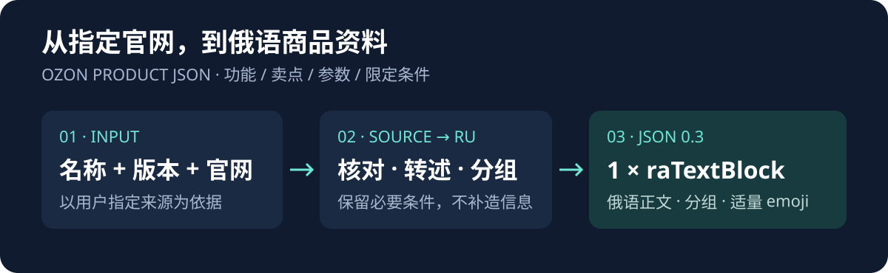

# Ozon 产品 JSON

<p align="center">
  <strong>把官方产品资料，整理成可直接用于 Ozon 的俄语富内容 JSON。</strong>
  <br />
  一个轻量的 Codex Skill：读取产品官网、提炼功能与参数、生成单个 <code>raTextBlock</code>。
</p>

<p align="center">
  
  
  
</p>

<p align="center">
  <a href="#快速开始">快速开始</a> ·
  <a href="#它能做什么">它能做什么</a> ·
  <a href="#内容规则">内容规则</a> ·
  <a href="SKILL.md">查看 Skill 定义</a>
</p>



## ✨ 它能做什么

输入产品名称、销售版本和官方产品页面，Skill 会整理官网中的主要功能、产品卖点、技术参数及必要的使用条件，并生成俄语富内容。

| 🔍 官方资料 | 🇷🇺 俄语内容 | 🧩 Ozon 格式 |
| --- | --- | --- |
| 产品功能与卖点 | 忠实转述为俄语 | 单个 `raTextBlock` |
| 型号、尺寸与参数 | 保留数字和单位 | 完整 JSON |
| 续航、兼容性与限制 | 保留必要条件 | 可复制到富内容编辑器 |

不同品类按产品实际资料组织内容，不会强行套用固定栏目。

## 🚀 快速开始

### 1. 安装

将仓库下载或克隆到本机，把文件夹放入 Codex 技能目录：

```text
~/.codex/skills/ozon-product-json/
├── SKILL.md
└── agents/
    └── openai.yaml
```

如果设置了自定义 `CODEX_HOME`，则放入该目录下的 `skills/ozon-product-json/`。

### 2. 提供产品信息

在可以读取该 Skill 的 Codex 会话中输入：

```text
使用 $Ozon 产品 JSON 
产品名称：HUAWEI WATCH GT 7
版本：Глобальная версия
官网：https://consumer.huawei.com/ru/wearables/watch-gt7/
```

只需提供产品名称、版本和指定官网。若销售某个特定尺寸或型号，也请一并注明。

### 3. 获取 JSON

Skill 将输出一个完整的 JSON 代码块。复制到 Ozon 富内容编辑器后，检查商品信息及页面展示即可。

## 🧭 内容组织

通常按产品实际情况组织以下信息：

- **主要功能与卖点**：突出产品能做什么。
- **使用条件**：保留兼容性、连接要求、地区限制及功能边界。
- **技术参数**：整理尺寸、屏幕、连接方式、电池等规格。
- **必要说明**：保留续航测试条件、防水边界、健康功能用途等重要限定。

## 📌 内容规则

- 以用户指定的官方页面为主要依据，可参考同品牌其他地区的同型号官方资料。
- 不同地区、型号或版本存在差异时，明确区分，不混用参数。
- 正文使用俄语，忠实转述产品资料，不自行添加未经证实的功能或卖点。
- 重要条件紧邻对应功能或参数，避免信息被误读。
- 缺乏官方依据的信息不写；关键资料无法确认时，说明缺口。

## 🧱 输出约定

| 项目 | 约定 |
| --- | --- |
| 顶层字段 | `content`、`version` |
| 版本号 | 数字 `0.3` |
| 内容组件 | 恰好一个 `raTextBlock` |
| 标题 | 产品名称与用户提供的版本 |
| 正文 | 俄语分组内容，适量使用 emoji |
| 交付 | 完整、可解析的 JSON |

所有分组都放在同一个文本块中，不拆分为多个组件。

## 📄 项目文件

- [SKILL.md](SKILL.md)：Skill 的完整指令与 JSON 输出模板。
- [agents/openai.yaml](agents/openai.yaml)：Skill 在 Codex 中显示的名称和默认提示词。
- [assets/readme/workflow.svg](assets/readme/workflow.svg)：项目工作流程图。

## 📜 开源协议

本项目采用 [MIT License](LICENSE)。
